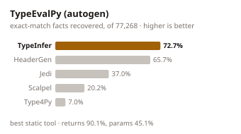
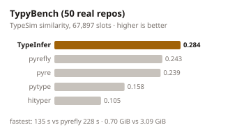
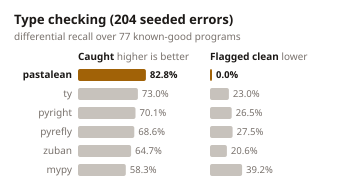
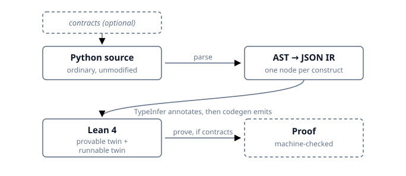

# PastaLean

<div align="center">

<p>Pasta for All - Python - in Lean4</p>
</div>

PastaLean transpiles Python code into Lean 4 and verifies it there. As the name suggests, it is not meant for one small use-case but for all Python code (well, as much of it as possible) and its behaviours. Modelling Python in Lean 4 is hard: Python is dynamically typed and, well, Python, making life easy for everyday users and harder for us.


> PastaLean originates from "PyAstLean" (which means Python to Lean via AST). Who doesn't love Pasta. It's Pasta for all, which if you didn't yet guess, comes from the Lean's "for all" logo.

**Blog:** [PastaLean: proving Python correct](https://anirudhg07.github.io/blogs/pastalean-proving-python-correct/) · **Paper:** [OpenReview](https://openreview.net/forum?id=7vrdqmHlL1)

## Table of Contents

- [Features](#features)
- [Results](#results)
- [How it works?](#how-it-works)
- [Type Inference (TypeInfer)](#type-inference-typeinfer)
- [Verifying with contracts](#verifying-with-contracts-and-how-postcondition-proving-can-fail)
- [Libraries](#libraries)
  - [How to add your own library](#how-to-add-your-own-library)
- [Install](#install)
- [Using PastaLean everyday](#using-pastalean-everyday)
  - [Command line](#command-line)
  - [Type checking](#type-checking)
  - [HTTP API](#http-api)
  - [Python API](#python-api)
  - [MCP server and skill](#mcp-server-and-skill-llm-driven-verification)
- [Testing](#testing)
- [Reproducing the paper results](#reproducing-the-paper-results)

## Features

- Transpiles Python code to Lean 4 code.
- The tool gives 2 functions for the same piece of code, one `provable` and one `computable`(marked with `'rn`).
- These functions have subtle differences in their implementation, for their respective purposes as you can guess.
- Verification of the code(using assert and contract statements) using tactics like `taste?`, `mvcgen`, etc.
- A standalone type inference engine and type checker for Python, [TypeInfer](#type-inference-typeinfer), that runs without Mathlib.

## Results

<table align="center">
<tr>
<td valign="top">

| Dataset | Elaborated | Tests passed |
|---|---|---|
| HumanEval⁺ | **151/164 (92.1%)** | **7,007/7,007 (100%)** |
| LeetCode | **2,391/2,589 (92.4%)** | **208,736/215,126 (97.0%)** |
| LiveCodeBench | **469/476 (98.5%)** | **10,213/10,213 (100%)** |

</td>
<td valign="top">

| | HumanEval⁺ | LiveCodeBench |
|---|---|---|
| LLM writes Lean, pass@1 | 75.4% | 52.5% |
| LLM writes Lean, pass⁵ (all 5 work) | 62.8% | 31.4% |
| **PastaLean, Lean compiles** | **92.1%** | **98.5%** |

</td>
</tr>
</table>

<p align="center">
  
  
  
</p>

*Elaborated* means the generated Lean type-checks. *Tests passed* means the runnable twin gives
CPython's answer on every one of that problem's test cases. The type checker's precision on
mypy_primer and the per-category numbers are under [Type checking](#type-checking) and in
[TypeInfer](#type-inference-typeinfer).

## How it works?

Let's give a brief overview of how PastaLean works here.

<p align="center"></p>

1. **Parse.** Python's own `ast` module parses the source, and [`node_visitor.py`](./src/transpile/node_visitor.py) turns the tree into a JSON IR, one object per node. A few Python-side passes tag it (IO/exception effects, library imports, top-level state).
2. **Annotate.** [`TypeInfer`](./TypeInfer/) infers a type for every binder it can and stamps it on the IR — it rewrites nothing else.
3. **Generate.** One persistent Lean backend (`py2lean`, booting Mathlib once) receives the IR a statement at a time; each node type has one `@[pygen "Node"]` generator in [`PastaLean/PyGens/`](./PastaLean/PyGens/) that emits typed Lean syntax calling the runtime in [`PastaLean/PyAPI/`](./PastaLean/PyAPI/).
4. **Elaborate.** The result is checked by Lean's elaborator — the oracle for whether a translation makes sense — and, if the Python carries contracts, the emitted spec theorems are proved with `taste?`/`mvcgen`.

The design rationale for each of these choices is in [`docs/design-choices.md`](./docs/design-choices.md).

### Some Unique Python Features and How we handle them

Python has some unique features that make it hard to model in Lean because of the differences in the type systems. Not just that, but also it's own special features which we are forced to model in Lean. Let's take a look at some of them:

<details><summary>Dynamic Typing</summary>

Python supports dynamic typing, while Lean is a statically typed language. The key to solving a lot of problems in modelling Python in Lean is to have a type system that can handle dynamic typing.
Among all the problems, this has been the toughest one. The answer we found was something called [Gradual Typing](https://jsiek.github.io/home/WhatIsGradualTyping.html). The idea is to have a special total fallback type — we call it `PyAny` in the code which any Python value can box into.

We constructed a [TypeInfer](./TypeInfer/) engine which can infer the types of the variables in the Python code, made a Lattice following the rules of gradual typing and fine-tuning it for Python's type system. It infers a _concrete_ Lean type (`Int`, `List String`, ...) wherever it can, and only falls back to `PyAny` for the slots it genuinely can't pin — so `PyAny` is rare, not everywhere.

For example: `int` and `bool` in Python can be used interchangeably in some cases (like `1 == True`), so we have to make sure that the type inference engine can handle this. `PyAny` has given us a lot of flexibility in modelling Python's dynamic typing in Lean.

</details>

<details><summary>Multiple Return Types</summary>

This is another tough one. Python allows for a function to return different types based on the input arguments. When the branches disagree, we box the result to `PyAny`; when they all agree, we return the specific type, as one would expect (and it stays provable).

```python
def classify(n):
    if n > 0:
        return "positive"   # str
    return 0                # int   ->  the whole function returns PyAny
```

_Why don't we make something like `Int | String` Union type?_
Well, we can do that, but then Python doesn't even follow that. A function saying it will return `int` in the signature can return a `str` in some cases. Dealing with that is a nightmare, rather simply returning `PyAny` is a better idea. It might not be precise, but it is sound, and it works.

</details>

<details><summary>Mutations, not just Values but also Types</summary>

We use simply `do` notation (with `let mut`) to model mutations in Lean. As long as the Type doesn't change, no fancy tricks needed.
But Python lets a variable _change type_ mid-function, so `TypeInfer` tracks each variable's type and, the moment two incompatible types meet in one slot, marks it `PyAny`.

Now `PyAny` is a _tagged union_ (`.int`, `.str`, `.list`, ...), and its operators are single delegating functions that **dispatch on the runtime tag**:

```python
x = 5        # x : PyAny (holds .int 5)
x = x + 1        # boxes 1 to PyAny, then +ₚ inspects both tags:
             #   both .int  ->  unwrap, do the Int addition, re-box as PyAny
```

So `x + 1` is _one_ operator (`PyAny.add`) looking at the tags — `.int + .int` does integer addition, `.str + .str` concatenates, `1 + "a"` softly yields `.none` — and re-boxing. The `Int` addition happens _inside_ on the unwrapped tag, not on a statically-typed `Int` we cast to and from. Container ops (`x[i]`, `len(x)`, `for e in x`) work the same way: they **delegate** to the boxed value's own `List`/`String` instance rather than reimplement anything.

</details>

<details><summary>What about Polymorphic Function?</summary>

> Polymorphic functions are functions that can operate on different types of data or objects, allowing the same function to perform similar operations on various types of inputs.

Yes, for example(this is for Parametric Polymorphism):

```python
def add(x, y):
    return x + y

add(1, 2)              # 3
add("Hello", "World")  # HelloWorld
```

If no types are given (or can't be inferred), we box the params to `PyAny` so _one_ definition works at every type. `add(1,2)` and `add("Hi","!")` both run off the same `def add (x : PyAny) (y : PyAny) := x +ₚ y` — the `+ₚ` (`PyAny.add`) dispatches on the runtime tags, exactly as above. Again: tag dispatch, not a cast round-trip.

</details>

<details><summary>Value Semantics — Python mutates in place, Lean doesn't</summary>

Python containers are mutable objects; Lean values are immutable. So an in-place mutation becomes a **rebuild-and-reassign**:

```python
xs.append(3)          #  ->  xs := pyAppend xs 3
d[k] = v              #  ->  d  := pySetItem d k v
```

The runtime helper returns a _new_ container, and codegen stores it back into the `let mut` variable. Library functions that mutate their argument (`heapq.heappush(h, x)`) declare this in `Libraries/`, and the core lowers them the same way (`h := pyHeappush h x`) — no library names live in the codegen.

</details>

<details><summary>Function Scoping vs Block Scoping</summary>

Python is **function-scoped**: a name assigned _anywhere_ in a function body — inside `if`/`elif`/`else`, `for`, `while`, `try`/`except`/`finally`, `with`, and **any depth of nested loop** — lives in the one enclosing function scope and stays visible after the block. Lean is **block-scoped**: a `let`/`let mut` inside a branch or loop body dies with that block. So a variable first bound inside a block and read outside it is **hoisted**: codegen pre-declares one enclosing `let mut x : T := default` before the block, and each branch/body assignment becomes a reassignment of that single variable.

```python
for i in range(n):
    for j in range(n):
        y = i * j     # first bound in the innermost loop...
return y               # ...still visible here (hoisted to `let mut y : Int := default` before the OUTER loop)
```

The type `T` comes from `TypeInfer`; a variable bound at _different_ types across branches becomes `PyAny` (initialised to `emptyPyAny`, i.e. `None`), so the branches box into one slot. The only constructs that get **their own** scope — matching Python 3 — are `def`, `lambda`, and comprehensions/generators; everything else shares the function scope.

</details>

<details><summary>None and Optional</summary>

Python's `None` and `Optional[T]` map to Lean's `Option`. Tree/linked-list fields default to `None`, so `TreeNode.left : Option TreeNode`; a field access then unwraps:

```python
root.val              #  root : Option TreeNode  ->  (root.getD default).val
```

</details>

<details><summary>Same Syntax, Different Semantics for Different Types(Ad-hoc Polymorphism)</summary>

We use TypeClasses and instances on different types, to model this. Best example is the `len` function.

```python
len([1, 2, 3]) # returns 3
len("Hello") # returns 5
len({"key": "value"}) # returns 1
```

We create a TypeClass called `PyLen` under which instances for Types like `List`, `String`, `Dict` are created. Each instance has its own implementation of the `len` function. See [PyLen](./PastaLean/PyAPI/CommonProtocols/Length.lean) for more details.

Similarly other functions behaving differently for different types but have the same syntax, are modelled using TypeClasses and instances.

</details>

<details><summary>Default Arguments</summary>

Yes, we support it.

```lean
def add (a : Int) (b : Int := (10 : Int)) :=
  a +ₚ b
```

If an argument's type is not given, `TypeInfer` infers it from the default value and from how the argument is used. If it cannot, the argument (and possibly the return type) falls back to `PyAny`, so annotate it when you want a provable function.

</details>

<details><summary>Two twins — one to prove, one to run</summary>

Every function is emitted twice: a **provable** version (exact `ℚ` for floats, `ℝ` for transcendentals, `noncomputable` where needed) and a **runnable** `'rn` twin (`Float`, fast). This is why Python's `/` — which is _always_ float division — shows up as `ℚ` in the prove twin and `Float` in the run twin.

```python
7 / 2     # prove twin: (7 : ℚ) /ₚ 2 = 7/2 exactly;   run twin: 3.5 : Float
```

</details>

<details><summary>Numeric coercion — bottom-up, never top-down</summary>

Python's numeric tower is `bool <: int <: float`: a value coerces _up_ only at the operator that mixes it with a wider type, driven by the **operands**, never by the surrounding context. `3 + 0.5` is `float` because `0.5` is; `3` on its own stays `int`. So `TypeInfer` promotes an int only where it actually meets a float (`int ⊔ float = float`), and a variable becomes `float` only if it is genuinely _assigned_ a float — a `-> float` return annotation (context) never forces it. This mirrors Lean: an `Int` stays `Int` and is cast to `ℚ`/`Float` at the mixed operation, not smeared everywhere.

```python
def avg(a: int, b: int):
    return (a + b) / 2   # `/` is float division -> ℚ (prove) / Float (run); a and b stay Int
```

`/` is _always_ float division; `//` is floor division; `%` and `**` follow Python's mixed-numeric rules.

</details>

<details><summary>`PyAny` can't be proved - `pyany_cases` tactic</summary>

`PyAny` makes us _total_ (everything runs), but it is **not** a commutative ring, so `ring`/`nlinarith`/`taste?` die on it — a boxed function can't be proved. That's why boxing is a _last resort_: infer a concrete type wherever possible, box only the residue, and in prove mode a linter warns at every `PyAny` binder ("annotate the type to prove"). Provability is the whole point of the project, so we protect it.

</details>

<details><summary>Object Oriented Programming</summary>

OOP is handled like namespaces. The `__init__` function is used to create the structure of the class, and the methods are added as functions under the namespace of the class. For example, a class `A` with a method `foo` will be modelled as a structure `A` with a function `foo` under the namespace of `A`. The methods can be called using the dot notation, like `A.foo()`.

Supported: `__init__`, methods, `@staticmethod`/`@classmethod`/`@property`, dunder operators, and single and multiple inheritance. By default classes have value semantics, so a mutating method rebuilds and reassigns the object. Pass `--heap` to opt into reference semantics, where instances alias like real Python objects (trees, linked lists). Highly dynamic tricks (monkey-patching, metaclasses, attributes added outside `__init__`) are not supported.

</details>

<details><summary>Exceptional Handling and IO</summary>

`try`/`except`/`raise` live in the `PyExcept` monad, and `print`/`input` are `IO`. You'll notice the wrapper often carries a `_` blank return type — that's on purpose: Lean _infers_ it. When the returns agree it becomes the concrete type (provable); when they disagree the function is boxed and the `_` becomes `PyAny`, so `try: return 1 / except: return "err"` just works (each branch coerces to `PyAny`).

```python
def describe(x):
    try:
        return x            # int
    except ValueError:
        return "negative"   # str   ->  def describe : Int -> PyExcept PyAny
```

</details>

<details><summary>Nested Functions & Closures</summary>

A **closure** is a nested function that reads a variable from the enclosing one — a _free variable_ it "closes over":

```python
def make_adder(n):
    def add(x):
        return x + n     # n is free in `add`; it belongs to make_adder
    return add
make_adder(5)(3)         # 8 — the returned `add` still remembers n = 5
```

**The Lean problem:** you can't just move `add` to the top level (it would lose `n`), and Lean has no mutable enclosing scope to point back at.

**How we deal — lambda lifting.** Every captured variable becomes an extra parameter of a **sibling `private partial def`** — `_make_adder'add := fun x n ↦ x + n` — passed at each call site (what's lifted is exactly `(names the inner reads) ∩ (names the outer binds)`; builtins/globals fall outside it). When the closure **escapes as a value** — returned, or a decorator's wrapper — we emit a genuine Lean closure that partial-applies the sibling with the captures baked in: `make_adder := fun n ↦ fun x ↦ _make_adder'add x n`. So returned closures, **currying**, and **decorators** all work, and stay **provable** — the sibling keeps its `[simp, taste_ingr]` tag, so `assert make_adder(5)(3) == 8` is proved automatically on conversion. (An un-inferable returned-closure param falls back to `PyAny`.)

**Mutation** (`nonlocal ans; ans += 1`) is _threaded_: the capture is both a parameter and part of the return, each call rebinding it. The one genuinely hard case is a closure that mutates a captured cell **and escapes** (a stateful `counter()`), which needs a real reference cell — still to come.

We use a sibling `private partial def` (not `where`/`let rec`, which would force the _outer_ def `partial` and lose its provability). It all lives in `PyGens/Transform/ClosureConvert.lean`.

</details>

<details><summary>Generators & <code>yield</code></summary>

A **generator** is a function that `yield`s a lazy stream of values. We **materialise it to a `List`**: the body is rewritten to build and return a list, so every consumer (`for x in g()`, `list(g())`, `sum(g())`, comprehensions) just sees an ordinary `List` handled by the existing `PyIterable` protocol — no new consumer machinery.

```python
def squares(n):
    for i in range(n):
        yield i * i          #  ->  __gen'acc.append(i * i)
list(squares(4))             # [0, 1, 4, 9]
```

Per generator, `yield e` → `acc.append(e)`, `yield from it` → `acc.extend(it)`, and `return` → `return acc` (in a generator, `return` just _stops_); the body is wrapped with `acc = []` … `return acc`. The `append`/`for`/`while` value-semantics threading is reused as-is. It lives in `PyGens/Transform/GeneratorLower.lean` and runs _before_ type inference, so the accumulator gets a real element type — which is what makes **recursive** generators (`yield from inorder(node.left)`, backtracking `subsets`/`permutations`) and generator **pipelines** (`for x in doubled(evens(data))`) work. (Materialisation is eager, so an _infinite_ generator consumed lazily won't terminate.)

</details>

<details><summary>Sequence backing: <code>List</code> to prove, <code>Array</code> to run</summary>

A Python `list` is a dynamic array — O(1) amortized `append`, O(1) index — but a `List α`-backed `xs = xs ++ [v]` is O(n) and `xs[i]` is O(i), so an append/index loop becomes **O(n²)**. We keep _both_ backings and use each where it wins. The **provable** twin (`fn`) stays `List α`: it is an inductive type with a free induction principle, so `taste?`/`mvcgen`, `omega`, and Mathlib's lemma library work naturally. The **runnable** twin (`fn'rn`) backs a `list` with `Array α` wherever every use is Array-portable, giving **O(1)** append/index.

That O(1) is Lean 4's reference-counting model — "functional but in-place" (FBIP): `Array.push`/`set!`/`get!` mutate in place when the array is uniquely owned, which the codegen's threaded mutation (`xs := pyArrayAppend xs v`, rebinding the same name) guarantees. See Ullrich & de Moura, _[Counting Immutable Beans](https://arxiv.org/abs/1908.05647)_ (IFL 2019) and Reinking, Xie, de Moura & Leijen, _[Perceus: Garbage Free Reference Counting with Reuse](https://www.microsoft.com/en-us/research/uploads/prod/2020/11/perceus-tr-v1.pdf)_ (PLDI 2021). Because `Array α` is _defined as_ `{ toList : List α }`, the two twins are the same value in two representations — not divergent implementations.

The choice is **per value**, decided at compile time (`List.toArray`/`Array.toList` are each O(n), so flipping per-operation would reintroduce O(n²)): `Array` by default (wins build-by-`append` + random index), `List` fallback for a value dominated by prepend / `insert(0,·)` / `pop(0)` (where `List` is O(n) and `Array` O(n²)) or by any op not ported to `Array`. Details in [`PastaLean/README.md`](./PastaLean/README.md#sequence-backing-list-prove-vs-array-run).

```python
def f(n):
    xs = []
    for i in range(n): xs.append(i)   # fn'rn: Array push, O(1)   |  fn: List ++, provable
    return sum(xs[i] for i in range(n))
```

</details>

<details><summary>Python Decorators</summary>

Python decorators are functions that modify the behaviour of other functions (`@d def f` means `f = d(f)`). A user-defined decorator is lowered by emitting the undecorated function and binding the decorated name to the application. Transparent decorators (`@cache`, `@staticmethod`, `@classmethod`, `@property`) leave the function's value unchanged. For example:

```python
def double(f):
    def w(x: int) -> int:
        return 2 * f(x)
    return w

@double
def inc(x: int) -> int:
    return x + 1
```

```lean
private def _double'w := fun (x : Int) ↦ fun (f : Int → Int) ↦ (2 : Int) *ₚ f x
def double := fun (f : Int → Int) ↦ fun (x : Int) ↦ _double'w x f
def inc'undecorated := fun (x : Int) ↦ x +ₚ (1 : Int)
def inc := double inc'undecorated
```

`TypeInfer` unifies the decorator's parameter with the function it decorates, so `f : Int → Int` above needs no annotation. Multiple decorators stack bottom-up, the one nearest the `def` first (`@a @b def f` is `a(b(f))`); see `example_scripts/general/decorators.py`.
You can declare your own decorators in Python or use commonly supported OOP/library decorators like `@staticmethod`, `@classmethod`, `@property`, etc. We support a few of them, and you can add more by writing Lean definitions for them and adding them.

</details>

<details><summary><code>@cache</code> / <code>@lru_cache</code> memoization</summary>

`@cache`/`@lru_cache` are value-transparent (memoization recomputes to the same result) but performance-critical: naive recursion recomputes exponentially. The **runnable** twin memoizes so exponential `@cache` DP runs in polynomial time; the **provable** twin stays the plain pure recursion (so it is still provable). The run twin is emitted as a `StateM`-threaded worker that shares one `HashMap` cache across the recursion, plus a pure wrapper that seeds a fresh cache per top-level call:

```lean
partial def fib'memo'rn : Int → StateM (Std.HashMap Int Int) Int := fun (n : Int) => do
  match (← get)[n]? with
  | some v => return v
  | none => let v ← (do if n < 2 then return n
                        else return ((← fib'memo'rn (n-1)) + (← fib'memo'rn (n-2))))
            modify (·.insert n v); return v
def fib'rn : Int → Int := fun (n : Int) => (fib'memo'rn n).run' ∅
```

Recursive self-calls in the body are lowered to `(← fib'memo'rn …)`, so the recursion threads the shared cache; `do`-notation hoists each `(←…)` to a bind. This is pure (no `unsafe`/global ref, so it runs under `lean --run` and native alike). It turns exponential recomputation into linear — the complexity-theoretic backing for memoization is Avanzini & Dal Lago, _[On Sharing, Memoization, and Polynomial Time](https://arxiv.org/abs/1501.00894)_ (Information and Computation, 2017).

**Coverage.** Params of type `int`/`bool`/`str` (a `Hashable`/`BEq` key); one param keys directly, several key on the tuple `(a, b, …) : A × B × …`. The common competitive-programming shape — a **nested `@cache dfs(i, j, …)`** (multi-arg, often capturing the grid/array) — works: closure-conversion lifts the `dfs` to a sibling def whose captures become trailing params, and the cache is keyed on the **original** params only (a capture is constant across the recursion and may be a non-hashable container, so it's threaded through but not keyed). What isn't memoised **falls back to the plain recursive def** (correct, just not faster): a self-call inside a ternary / `and` / `or` / lambda / comprehension (a `(←…)` can't hoist out of a lazily-evaluated position) or a param whose type isn't inferred. `example_scripts/general/decorators.py` exercises the memoised path.

</details>

...and many, many more small annoying features. [`docs/design-choices.md`](./docs/design-choices.md) walks through all of them.

## Type Inference (TypeInfer)

Python is dynamically typed, but Lean needs types. `TypeInfer` is PastaLean's type-inference engine: it runs over the Python AST before code generation and assigns every parameter, return, variable and field a type from a single `PyType` lattice, so untyped Python can be lowered to well-typed Lean. It also runs over a whole repository, flowing types across files and imports.

It is built as its own Mathlib-free Lean binary, so you can use it on its own — as a fast static type annotator for Python, independent of the transpiler:

```bash
lake build typeinfer

pastalean typeinfer script.py                 # print the source with inferred annotations
pastalean typeinfer script.py -o out.py       # write annotated source to a file
pastalean typeinfer script.py --format stub   # emit a .pyi stub instead
pastalean typeinfer script.py --coverage      # per-dimension type-coverage report
pastalean typeinfer script.py --check         # type-check it: Lean-style errors, exit 1 if any
pastalean typeinfer my_project/               # repo mode: annotate a whole project
```

**On benchmarks.** On the file-level TypeEvalPy benchmark, TypeInfer is the top-scoring static tool on the micro set and leads on return and parameter facts on the autogen set. On the repository-level TypyBench benchmark (50 real projects with their annotations stripped) it leads every accuracy metric against the other inference-capable tools (pyrefly, pyre, pytype), while being the fastest at repository scale and using less memory than every tool except hityper. On the TypeEvalPy autogen set (5,453 snippets, 77,268 facts, exact match):

| Tool | Return | Param | Var | Matched | Match |
|---|---|---|---|---|---|
| **TypeInfer** | **16,220** | **404** | **39,560** | **56,184** | **72.7%** |
| HeaderGen | 14,086 | 346 | 36,370 | 50,802 | 65.7% |
| Jedi | 13,160 | 0 | 15,403 | 28,563 | 37.0% |
| Scalpel | 15,383 | 171 | 18 | 15,572 | 20.2% |
| Type4Py | 3,143 | 38 | 2,243 | 5,424 | 7.0% |

pyrefly takes the overall total there (78.6% to 72.7%) on the strength of variable types, while
TypeInfer leads on returns and parameters — the two a transpiler needs. The TypyBench numbers are
charted in [Results](#results); to regenerate any of them, see [Reproducing the paper results](#reproducing-the-paper-results).

## Verifying with contracts (and how postcondition proving can fail)

You annotate a Python function with `Requires`/`Ensures` (plus `Invariant`/`Decreases`/`Assert`), and
PastaLean turns it into a Hoare-triple spec on the provable twin:

- **precondition** = the conjunction of every `Requires`/`Assume`,
- **postcondition** = the conjunction of every `Ensures` (and every `Result()`-bearing `Assert`),
- a bare `Assert(...)` about _intermediate_ state stays an in-body checkpoint (a no-op), and
  `Invariant`/`Decreases` drive the loop's `mvcgen` proof,
- the postcondition is `True` **only** when the function declares no `Ensures`/`Result`-`Assert` at all
  — and a `True` postcondition asserts _nothing_, so it proves trivially and verifies nothing.
- `Ensures`/`Result`-`Assert` must sit at the start/end of the body, never sandwiched _between loops_
  (that would be a program-point checkpoint, not a postcondition) — PastaLean rejects that.

The transpiler emits the spec and tries to discharge it automatically (`taste?`/`mvcgen`). **But a
compiling spec is not a proved spec** — and worse, **a postcondition can be flat-out false**, in which
case no proof exists. This is the single biggest way verification "fails miserably":

```python
def missingNumber(arr: list[int]) -> int:
    Requires(len(arr) >= 1)
    Requires((arr[-1] - arr[0]) % len(arr) == 0)
    # ⚠️ FALSE as a postcondition. It only holds when `arr` is a genuine arithmetic
    #    progression missing exactly one term — a property the two Requires do NOT capture.
    Ensures(min(arr[0], arr[-1]) <= Result() <= max(arr[0], arr[-1]))
    return (arr[0] + arr[-1]) * (len(arr) + 1) // 2 - sum(arr)
```

For `arr = [0, 50, -99]` both `Requires` hold (`len == 3`, `(-99 - 0) % 3 == 0`), but the function
returns **-149**, while `min(0, -99) == -99` — so `-99 <= -149` is false. The postcondition is
unprovable because it is _not true_. PastaLean will happily generate the `_spec` theorem and it will
sit there with a `sorry` forever: **the contract, not the prover, is the bug.**

Two lessons:

1. **Strengthen the precondition** to the domain where the property holds ("`arr` is an arithmetic
   progression"), or **weaken the postcondition** to something true (e.g. the direct
   `Ensures(Result() == (arr[0] + arr[-1]) * (len(arr) + 1) // 2 - sum(arr))`).
2. Even a _true_ postcondition can be out of automated reach — a functional characterization like
   `Ensures(Result() == number_of_pairs(i, j) with i < j and words[i] == reverse(words[j]))` is true
   but needs a bespoke inductive proof; `taste?`/`mvcgen` will leave a `sorry`, and that is expected.

## Libraries

Python libraries are supported by writing Lean definitions for the library's API, plus a `Mapping.lean` that maps each Python member name to its Lean definition. No library names live in the code generator. Shims currently ship for `math`, `bisect`, `collections`, `functools`, `hashlib`, `heapq`, `itertools`, `operator`, `random`, `string`, `sortedcontainers`, `numpy`, `pandas` and `scipy` (`pastalean libraries` lists them).

For example, see the [math](./Libraries/math/) library, which uses Mathlib to implement Python's `math` module.

### How to add your own library

You have two options, either download a premade Lean library for that Python library(from GitHub) or write your own Lean definitions for the Python library and create Mappings for the functions you want to support.

See [Libraries](./Libraries/) for examples of how to add a library and use it.

## Install

You need [elan](https://github.com/leanprover/elan) (the toolchain is pinned by `lean-toolchain`) and [uv](https://docs.astral.sh/uv/) for the Python side. From the repository root:

```bash
lake exe cache get   # fetch prebuilt Mathlib
lake build           # builds the PastaLean runtime and the py2lean backend
uv sync              # Python environment in .venv/
```

To use the runtime as a Lean library, add it to your `lakefile.toml`:

```toml
[[require]]
name = "PastaLean"
git = "https://github.com/siddhartha-gadgil/PastaLean"
rev = "master"
```

## Using PastaLean everyday

We give a Python API for developers to run a backend server and translate Python to Lean on the fly. We use `uv` for Python environment management. It creates `.venv/` and installs the project and its console script on first use, so there is no separate install step:

```bash
uv sync
uv run pastalean translate prog.py
```

or install it yourself, which additionally puts `pastalean` on your PATH:

```bash
uv pip install -e '.[server]' # drop [server] if you don't want the HTTP API
pastalean translate prog.py
```

### Command line

```bash
pastalean translate prog.py              # Python -> Lean on stdout, then compile-check it
pastalean run       prog.py < input.txt  # translate, compile, execute
pastalean json      prog.py              # dump the intermediate JSON IR
pastalean typeinfer prog.py              # infer Python types (no Lean compile)
pastalean batch     example_scripts/commands -o out/ --check   # many files, one warm backend
pastalean serve                          # web playground + HTTP API
pastalean libraries                      # Python libs with a Lean shim
```

`translate` and `run` also accept the LLM source rewrites `-r/--redesign` (restructure for
provability) and `-c/--contracts` (insert Requires/Ensures/Invariant). Both write the transformed
program to a sibling `.py` so you can read what the model produced.

`typeinfer` runs the standalone TypeInfer engine (a compiled Lean binary, no Mathlib boot) over a
file and infers types for parameters, returns, local variables, and class fields — inference only,
no code generation. By default it prints the source back with PEP 484 annotations injected (bare
`Any` included, with `from typing import Any` added); `--format` switches the output shape:

```bash
pastalean typeinfer prog.py                    # annotated Python on stdout (default)
pastalean typeinfer prog.py --no-any           # ...but skip bare `Any` (list[Any] etc. kept)
pastalean typeinfer prog.py --format json      # machine-readable type map
pastalean typeinfer prog.py --format list      # human-readable listing grouped by scope
pastalean typeinfer prog.py -r                 # + a summary: counts per dimension and time taken
```

Give it a **directory** and it infers the whole repository in one Lean fixpoint — resolving imports
so types flow across files — and writes an annotated copy (default `<dir>_typed`, or `-o <dir>`):

```bash
pastalean typeinfer myrepo/ -o myrepo_typed -r
```

Inference is parallel inside the engine: a batch or a repo fans out across the machine's cores in a
single process (no per-file backend boot).

#### Type checking

`--check` **type-checks** instead of inferring: the Lean checker (`TypeInfer/Diagnostics/`) reports
every annotation the body contradicts and every slot whose uses no single type satisfies, prints
nothing when the file is clean, and exits non-zero when it is not. Errors read like Lean's, because
what is really being checked is the Lean the transpiler would emit — the Python type rides along as
a line comment:

```bash
pastalean typeinfer prog.py --check            # type errors, Lean-style; exit 1 if any
pastalean typeinfer myrepo/ --check            # every file under the directory
pastalean typeinfer prog.py --check --format list    # one line per error
pastalean typeinfer prog.py --check --format github  # or sarif, for CI
pastalean typeinfer prog.py --unresolved       # the other CI mode: slots left untyped
```

A directory runs full throttle by default, the same way inference does: the front-end builds every
IR across a process pool, then the `checkBatch` task fans the modules across the machine's cores
inside the exe (sharded over several exe processes past one process's ceiling). `-j/--jobs` caps it.
One file is ~45 ms end-to-end, and all 165 `example_scripts/` programs check in under 0.4 s.

```
prog.py:4:11: error: type mismatch
  total.n
has type
  String  -- python: str
but is expected to have type
  Int     -- python: int
```

Four judgments feed it: a parameter annotation against its body's uses, a return annotation against
the body re-inferred with every return type stripped, a local `x: T = e` against its value flow, and
each call argument against the parameter it is passed to. On a seeded-error benchmark — 204 mechanical
annotation flips over 77 known-good programs, scored differentially (credit only when the mutant is
flagged and its untouched original is not) — it catches the most of any checker while being the only
one that never flags a known-good file:

| Tool | Caught | Flagged clean | Time |
|---|---|---|---|
| **pastalean** | **169 (82.8%)** | **0 (0.0%)** | 0.8 s |
| ty | 149 (73.0%) | 47 (23.0%) | 0.1 s |
| pyright | 143 (70.1%) | 54 (26.5%) | 5.5 s |
| pyrefly | 140 (68.6%) | 56 (27.5%) | 0.5 s |
| zuban | 132 (64.7%) | 42 (20.6%) | 1.6 s |
| mypy | 119 (58.3%) | 80 (39.2%) | 1.5 s |

Reproduce with `PastaBench/typecheck_bench/mutate.py` and `bench_checkers.py`. The corpus is
`example_scripts/`, Python that PastaLean fully supports; the "flagged clean" column is mostly extra
strictness for the other tools rather than a bug, which is exactly why recall is scored
differentially. One caveat: those originals are the corpus PastaLean's own filters were written
against, so the zero has home advantage — the differential rule protects the *caught* column, not the
*flagged clean* one.

#### False positives on the mypy_primer corpus

204 mutants of our own examples is a recall test, not a precision test. For that we use
[mypy_primer](https://github.com/hauntsaninja/mypy_primer)'s project list — the corpus mypy,
pyright, ty and pyrefly all run their own regressions against. Its selection rule is what makes it
useful: a project is on the list only if it already type-checks in its own CI, so **every diagnostic
PastaLean emits on it is a candidate false positive**.

```
mypy_primer corpus: 158 projects, 68,542 .py files CHECKED
  diagnostics       294 (4.29 per 1000 files)
  front-end failed  6,221 (IR could not be built; excluded from the rate above)
  timed out         8 files (> 90s, bisected)
  wall              2,343s (29 files/s)
```

One diagnostic per ~230 files, on 10M lines nobody here wrote, with nothing skipped for size. The rate
is over files whose IR was actually built; earlier runs (238 / 72,923) also counted unparsed files in
the denominator, so the two are not comparable — see
[`docs/typeinfer-certificates.md`](./docs/typeinfer-certificates.md#precision-at-scale-mypy_primer).
The 8 timeouts are a known recursion in local-import inlining, not in the checker. The largest module in the corpus is a 4.1 MB
generated test (`manticore/tests/native/test_x86.py`) at 12.8 s; the 33k-line GraphQL schema dump
that used to run for minutes is 3.7 s. Both were the same bug: the signature fixpoint propagated
inherited members by rescanning the whole table for every subclass/base pair on every pass, which is
cubic in the class count. Indexing by owning class made it linear. Of the survivors a visible share are
genuine: `beartype` and `black` ship deliberately ill-typed fixtures, and Home Assistant really does
`return 0` from a `-> None` function. Reproduce with

```bash
uv run PastaBench/typecheck_bench/primer.py fetch     /tmp/primer   # ~3.5 GB, shallow
uv run PastaBench/typecheck_bench/primer.py precision /tmp/primer
```

The sweep is what the current filters were written against: a class must be in a method's scope path
(two `__exit__`s in one module are not one slot), a judgment may not name a class the module does not
define (a `TypeVar` is a binder, not a nominal type), a use-conflict is reported only between two
committed scalars, and a `yield` function's `-> None` is not contradicted by the list its
materialisation builds. Together those took the corpus from 860 diagnostics to 234 (under the older
accounting) at **no cost to recall** — still 169/204.

What the corpus does *not* give us is a scoreboard. The published one is the
[typing conformance suite](https://github.com/python/typing/tree/main/conformance), scored by exact
per-line agreement with inline `# E:` markers. Diagnostics now carry `line:col`, so that rule is no
longer the blocker; what still is, is coverage — the suite tests `Protocol`, `ParamSpec`,
`TypedDict`, `overload` and variance, and only a third of its files survive a subset transpiler's
front end.

### HTTP API

We provide an HTTP API on default port `6789`:

```bash
pastalean serve                 # reachable from the LAN; prints this machine's URL
pastalean serve --no-ip         # localhost only
```

This provides the below features for you to use PastaLean -

_Web UI_:

- Paste Python and press **Translate** to see generated Lean with syntax highlighting and compile errors, if any.
- **Insert contracts** runs the `--contracts` LLM pre-pass and shows the annotated Python in its own box, ready to use as the source.
- Provide an API key and select model to use for contracts. You can also write a custom prompt as a goal for LLM for what you want the contracts to achieve. The settings are available under **Settings**.
- You can see the generated Lean code and the contracts in their own boxes, with syntax highlighting and compile errors, if any.

_HTTP API_:
In one shell, you can run:

```bash
uv run pastalean serve
```

In another shell you can test the API with `curl`:

```bash
curl -s localhost:6789/translate -H 'content-type: application/json' \
     -d '{"source": "def f(x: int) -> int:\n    return x + 1\n"}'

curl -s localhost:6789/run -H 'content-type: application/json' \
     -d '{"source": "def main():\n    print(int(input()) + 10)\n\nif __name__ == \"__main__\":\n    main()\n",
          "stdin": "32\n", "mode": "run"}'      # -> {"stdout": "42\n", "exit_code": 0, ...}
```

Invalid Python returns HTTP 400. One Lean backend serves every request and translation drives
process-wide state, so requests are serialised behind a lock — this is a single-worker service by
construction.

### Python API

You can also use PastaLean from Python once the package is installed in your virtual environment (the Lean side must be built too, see [Install](#install)):

```python
import pastalean

result = pastalean.translate_file("prog.py", mode="run")
if result.ok:
    print(result.lean_code)

# Many files, one Lean boot:
with pastalean.Session(target="command", mode="run") as session:
    for result in session.translate_files(paths):
        ...
```

Booting the backend imports Mathlib (the first run is slow, later ones are faster), so a `Session` is much faster than one process per file. `pastalean.compile_check` and `pastalean.run_program` take Lean text
and shell out to `lake env lean`.

### MCP server and skill (LLM-driven verification)

`pastalean mcp` runs a [Model Context Protocol](https://modelcontextprotocol.io) server over stdio,
so an LLM client can verify Python logic itself. It writes contracts, translates, proves the emitted
theorems, and gets a verdict it cannot game. Install the extra with `uv pip install -e '.[mcp]'`.
The repo's `.mcp.json` registers the server for Claude Code automatically.

| Tool | What it does |
|---|---|
| `translate_python` | Python → Lean (both twins). Returns an editable `lean_path`, the proof obligations, and whether anything degraded to `pyUnsupported` |
| `check_lean` | Elaborate Lean and return diagnostics, for iterating on a proof |
| `verify_theorems` | **The verdict.** Compiles, audits each theorem with `#print axioms` (no `sorry`, `native_decide` or extra axioms), and checks every `def` and theorem statement is still exactly what was translated. Only theorems and lemmas may be added |
| `run_differential` | Runs CPython and the runnable twin on a `__main__` and compares their output |
| `typecheck_python` | The TypeInfer type checker |
| `find_definition`, `search_lemmas`, `grep_source`, `read_source` | Explore the runtime: what `pyAppend` computes, which lemmas exist about it |
| `get_guide`, `list_proved_examples`, `get_example` | The contract guide, the proving guide (`docs/proving-with-pastalean.md`), and the fully proved PastaBench examples |

The matching skill, `.claude/skills/verify-python/SKILL.md`, gives the workflow: contracts →
translate → prove only the proofs → `verify_theorems` → differential check → an honest report
(proved / false with a counterexample / not yet proved).

## Testing

PastaLeanCheck (PALC) (pronounced "pal" + "ack", like PAL Acknowledge) is the testing framework for PastaLean. It translates every Python program under `example_scripts/` in one warm pass and compile-checks the generated Lean in-process. Each file gets a verdict (`OK`, `CONVERT_FAIL`, `COMPILE_FAIL` or `UNSUPPORTED`), and any non-`OK` fails the run. There are no golden files: the Lean elaborator is the oracle. Runtime unit checks (`#guard`s under `PALC/PyAPI/` and `PALC/Libraries/`) are built along with it.

To run all tests:

```bash
lake test
```

To run PALC on a single file or directory:

```bash
lake exe palc <file.py | dir>
```

To add coverage, drop a representative `.py` into the matching `example_scripts/` subdirectory.

## Reproducing the paper results

Every table and figure in the paper can be regenerated from this repo. [`REPRODUCE.md`](./REPRODUCE.md) has the full guide: one command per experiment, each naming the paper artifact it produces and the file it writes.

After the setup in [Install](#install), build the Lean targets the harnesses need:

```bash
lake build py2lean      # transpiler backend
lake build typeinfer    # standalone Mathlib-free inference binary
lake build PastaBench   # verification library (proving experiment)
```

Then the main experiments:

```bash
# Code generation and execution (HumanEval / LeetCode / LiveCodeBench)
python3 PastaBench/pastaeval.py humaneval --run
python3 PastaBench/pastaeval.py cp --source leetcode --num max

# Type inference (TypeEvalPy micro + autogen, and the production checkers)
python3 PastaBench/pastaeval.py typeinfer
bash PastaBench/typeinfer_bench/run_autogen.sh
uv run python PastaBench/typeinfer_bench/bench_checkers.py

# Repository-level type inference (TypyBench, vs pyrefly/pyre/pytype)
python3 PastaBench/typybench_bench/score.py <dataset_dir> --tool pastalean
#   swap --tool for pyrefly | pyre | pytype to score the baselines
```

See [`REPRODUCE.md`](./REPRODUCE.md) for dataset setup, exact flags, the LLM baseline, and the contracts/proofs.

